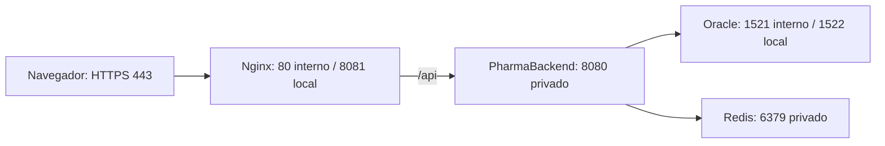

# PharmaBackend

## Despliegue en producción

### Arquitectura y puertos

El entorno de práctica usa HTTP local en 8081; HTTPS 443 es la propuesta para los tres locales. SPA y API comparten origen. Redis queda ligado a 127.0.0.1 en Compose; el backend actual corre en el host.

### Variables de entorno (sin valores reales)

| Variable | Propósito |
|---|---|
| SPRING_PROFILES_ACTIVE | Seleccionar prod |
| DB_URL | URL JDBC de Oracle |
| DB_USERNAME / DB_PASSWORD | Usuario y contraseña del esquema |
| JWT_SECRET | Clave aleatoria Base64 de al menos 256 bits |
| JWT_EXPIRACION_MINUTOS | Duración del token |
| REDIS_HOST / REDIS_PORT | Servidor de caché |
| SERVER_PORT | Puerto del backend |
| FRONTEND_ORIGINS | Orígenes permitidos separados por coma; definir explícitamente en producción |

### Construcción, despliegue y vuelta atrás

1. Registrar commits exactos de ambos proyectos y respaldar Oracle. Probar restauración.
2. Backend con Java 21: `./mvnw.cmd package`; no omitir pruebas en la entrega.
3. Frontend: `npm install` y `npm run build -- --stats-json`.
4. En frontend: `docker compose -f deploy/docker-compose.yml up -d`. Comprobar Redis PONG.
5. Definir secretos en el entorno, activar prod y ejecutar `java -jar target/PharmaBackckend-0.0.1-SNAPSHOT.jar`. Oracle debe estar disponible; Flyway gestiona migraciones y Hibernate valida.
6. Publicar assets antes de index.html. Abrir 8081 local o el dominio HTTPS en producción. Probar login, lectura, venta/stock, health y permisos de métricas.
7. Si falla: detener únicamente la nueva instancia, restaurar JAR y build estático de la versión anterior, reiniciar y repetir pruebas de humo. Conservar chunks antiguos mientras existan sesiones abiertas. Una migración destructiva exige su procedimiento de restauración; no basta volver al JAR anterior.

### Estado de buenas prácticas de la sesión

| Práctica | Estado | Acción pendiente |
|---|---|---|
| Secretos de producción fuera de Git | Cumple parcialmente | Mantener credenciales de demostración solo en dev; usar almacén de secretos real |
| prod con ddl-auto validate y Flyway | Cumple | Verificar permisos y respaldo antes de migrar |
| Swagger y SQL desactivados en prod | Cumple | Confirmar en cada despliegue |
| CORS explícito / mismo origen | Cumple | Configurar FRONTEND_ORIGINS con dominios reales |
| HTTPS público | No cumple | Terminar TLS en Nginx/proxy del servidor |
| Build con budgets activos | Cumple | Mantener aviso inicial 360 kB y error 1 MB |
| Hashes, caché larga e index revalidable | Cumple | Conservar assets antiguos en despliegue; definir política de imágenes/fuentes |
| Health de backend, Redis y Nginx | Cumple parcialmente | Redis tiene healthcheck; automatizar comprobaciones de web y backend |
| Logs rotativos con identificador | Cumple | Recoger y proteger logs; limitar retención y acceso |
| Versión Git etiquetada y rollback | Cumple parcialmente | Hay commits/PR y procedimiento; falta etiqueta de release y ensayo de rollback |

### Tres recomendaciones para los tres locales

1. **Alta: proteger acceso y secretos.** Un dominio HTTPS para los tres locales; API, Oracle y Redis en red privada/VPN; identidades propias por empleado, sin cuentas compartidas.
2. **Alta: asegurar continuidad de datos.** Backend cercano a Oracle, respaldo cifrado y restauración ensayada; plan ante caída del enlace de un local. No mantener tres bases independientes sin estrategia de sincronización.
3. **Media: caché y observabilidad compartidas.** Un Redis lógico compartido por las instancias del backend, con TTL e invalidación consistente; monitorizar capacidad y disponibilidad, evitar un punto único de fallo y alertar por health, errores y latencia. Redis no reemplaza Oracle.
